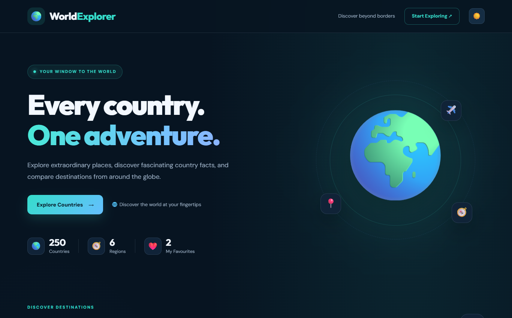
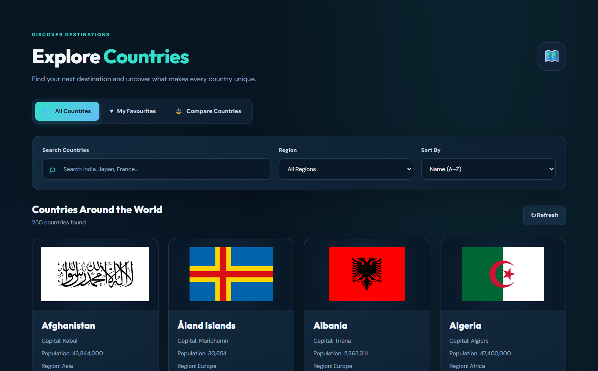
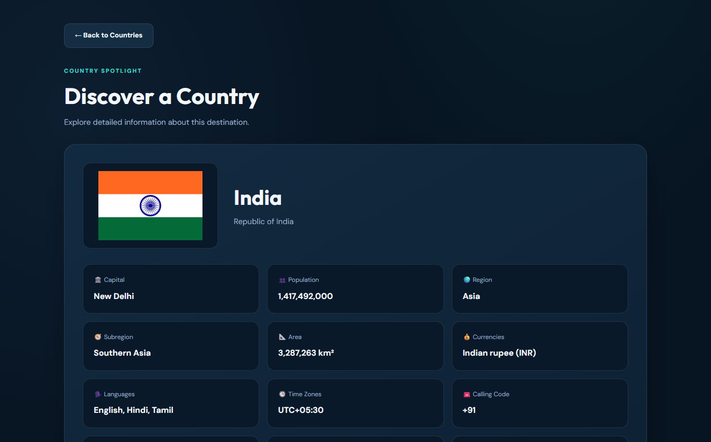
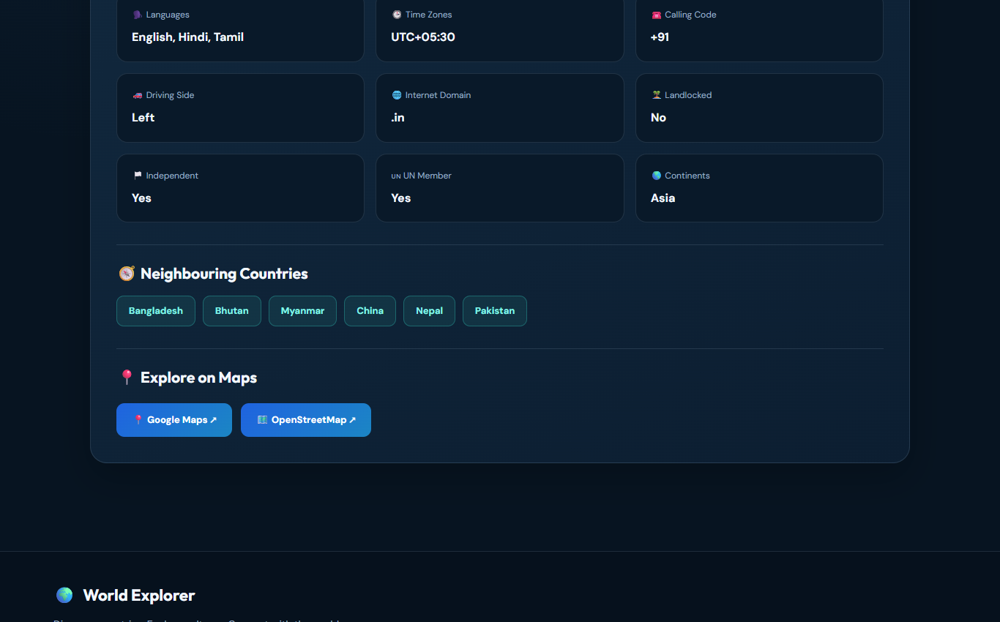
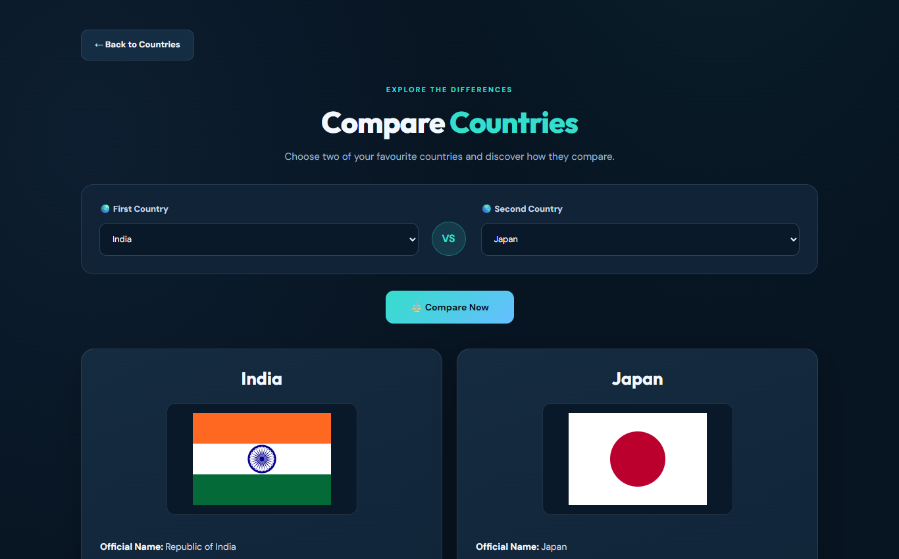
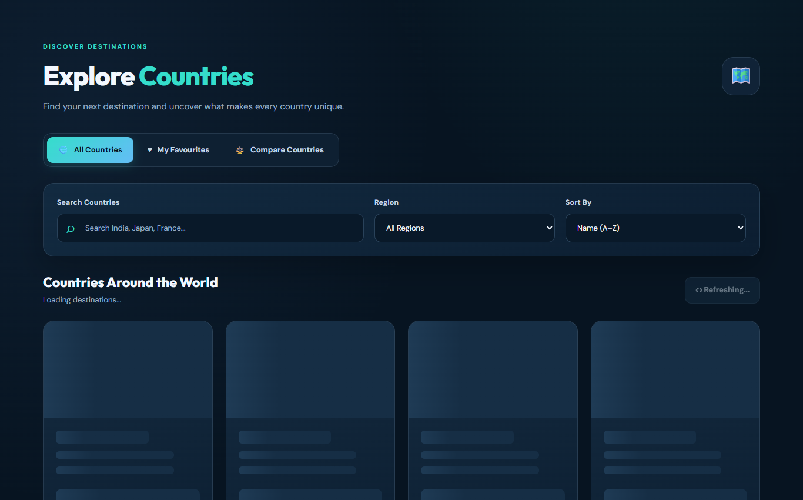
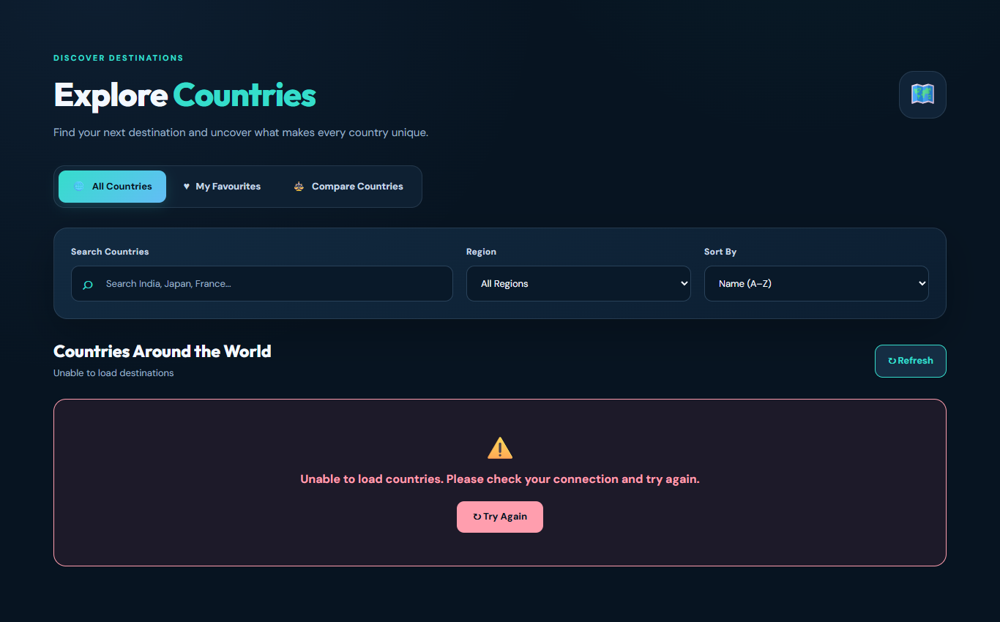
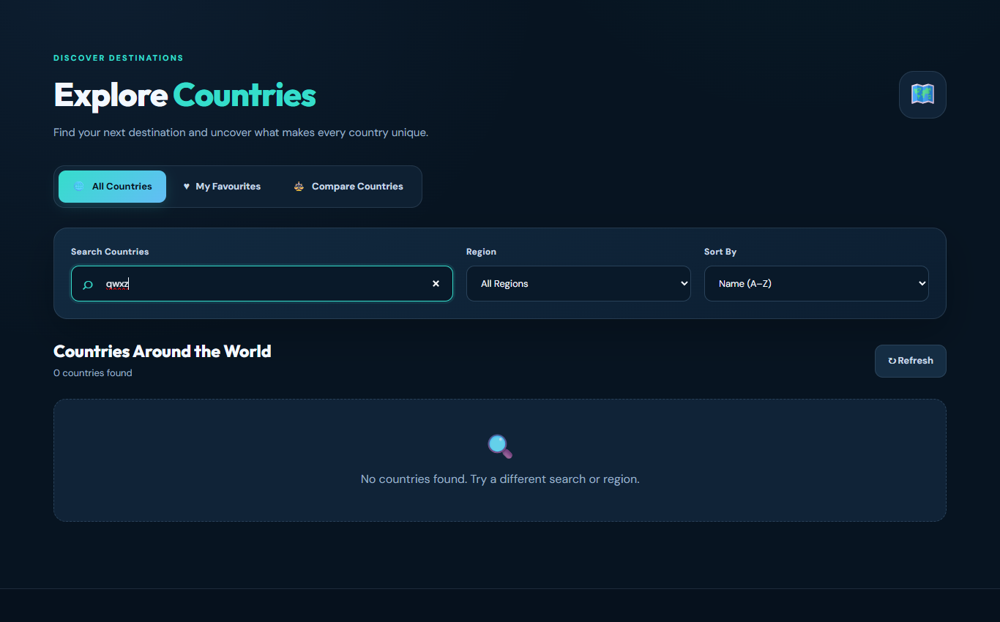
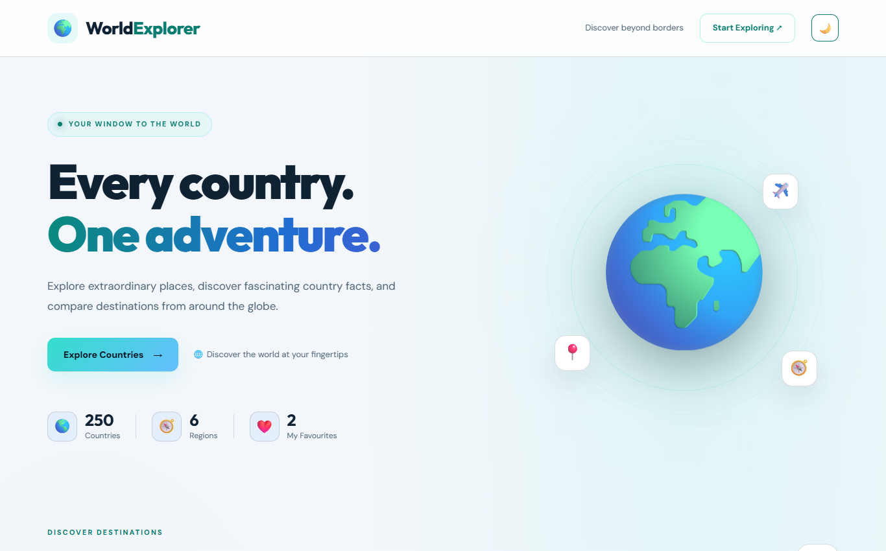
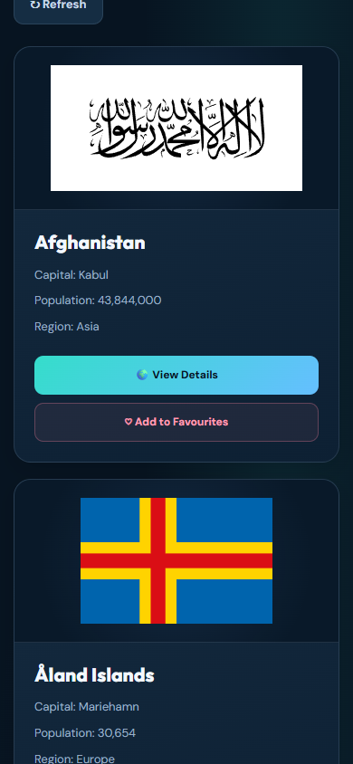

# 🌍 World Explorer

A country discovery app built with vanilla JavaScript, with no frameworks or libraries. Browse all 250 countries, search and filter them, open a detailed profile, save favourites and compare two side by side.

**Live demo:** https://world-explorer-zeta-ten.vercel.app

**Milestone 2, Option C (World Explorer)** · Full Stack + AI Engineering Program



## Features

- **Browse:** every country as a card with its flag, name, capital, population and region
- **Search:** by common or official country name, debounced so the list only updates once typing pauses
- **Filter and sort:** by region, and by name, population or area
- **Country details:** currencies, languages, time zones, calling code, driving side and more, with Google Maps and OpenStreetMap links
- **Border chips:** click a neighbouring country to jump straight to its details
- **Favourites:** saved in LocalStorage, so they survive a page refresh
- **Compare:** view two favourites side by side
- **Refresh:** re-fetches the data without reloading the page
- **Loading, error and empty states:** skeleton cards, an error panel with a retry button, and a "no results" message
- **Dark and light themes:** your choice is saved in LocalStorage
- **Responsive:** works on mobile, tablet and desktop

## API

Country data comes from the [REST Countries](https://restcountries.com) dataset, using the v3.1 format.

`restcountries.com` has retired its free v3.1 endpoints, and its v5 API requires a private key, which can't be kept secret in a frontend-only app. This project therefore uses **Countrydrop**, a free, no-key mirror with the same paths and JSON:

```
GET https://pw-d20261017a29.plainwork-apps.workers.dev/v3.1/all?fields=name,flags,capital,population,...
```

## How it works

| Requirement | Approach |
| --- | --- |
| Rendering 250 countries smoothly | Cards are added in batches of 40 as you scroll (`IntersectionObserver`), and flag images load lazily |
| Event delegation | One click listener on the card grid handles details, favourite and retry buttons, and one on the details panel handles border chips |
| Async requests | `fetch` with `async/await` inside `try/catch`, and only one request can run at a time, so responses can't arrive out of order |
| Favourites | An array of country codes stored as JSON in LocalStorage under `worldExplorerFavourites` |

## Screenshots

| Browse | Country details |
| --- | --- |
|  |  |

| Border chips and map links | Compare favourites |
| --- | --- |
|  |  |

| Loading | Error (offline) |
| --- | --- |
|  |  |

| No results | Light mode |
| --- | --- |
|  |  |



## Tech stack

HTML5 · CSS3 (custom properties, Grid, Flexbox) · JavaScript (ES6+) · Fetch API · LocalStorage · Vercel

## Project structure

```
world-explorer/
├── index.html      Page structure
├── style.css       Styles, themes and responsive layout
├── script.js       Data fetching, rendering and interactions
├── screenshots/    Images used in this README
└── README.md
```

## Run locally

```bash
git clone https://github.com/khushi898/world-explorer.git
```

Open the `world-explorer` folder in VS Code and open `index.html` with the Live Server extension. There is nothing to install.

## Author

Khushi Patel · [GitHub](https://github.com/khushi898/world-explorer)

Created as an educational portfolio project.
